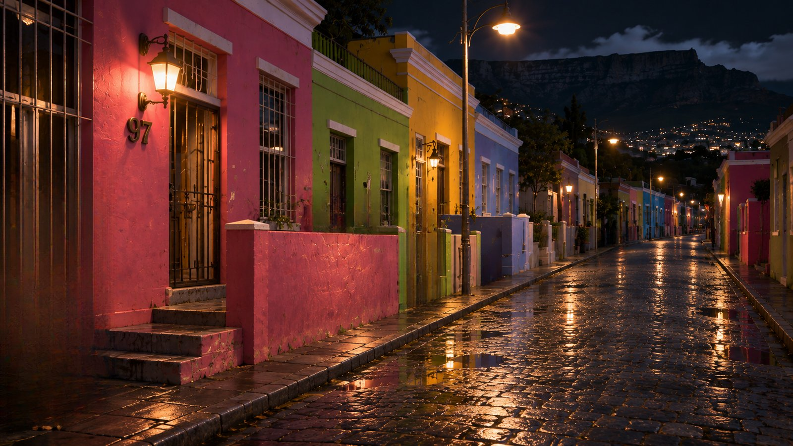
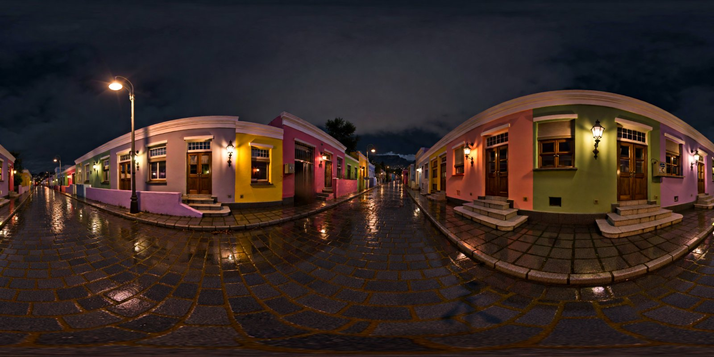

# local-gen: run IMAGE-BLASTER on your own GPU

Drop-in local replacements for the FAL-hosted steps of IMAGE-BLASTER, built and tested on an
**RTX 5060 Laptop GPU (8 GB VRAM, Blackwell sm_120)** running Ubuntu.

FAL is pay-per-use, and my account was locked once its balance ran out (`403 User is locked. Reason: Exhausted balance`).
I rebuilt the plate, upscale, and 3D steps so they run on the laptop GPU instead. World Labs stays in the cloud.
Every script writes the same indexed files (`N-slug.ext` + hidden `.N-slug-request.json`) as the original
pipeline, so the viewer picks the results up with no app changes.

| step | original (cloud) | local-gen (your GPU) | VRAM |
|---|---|---|---|
| clean plate | FAL nano-banana / gpt-image-2 edit | **LaMa** (`plate_lama.py`) | ~2 GB |
| plate sharpening | none | **Real-ESRGAN x4plus**, tiled fp16 (`upscale_esrgan.py`) | ~1.5 GB |
| object reference | FAL image edit | crop + **Real-ESRGAN** + **BiRefNet** cutout | ~1.5 GB |
| image → 3D | FAL Hunyuan 3D | **Stable Fast 3D** (`object_sf3d.py`) | ~6.1 GB peak |
| world | World Labs `marble-1.1` | unchanged (cloud) | none |

## Pipeline showcase: Rainy Bo-Kaap at night

| original input | LaMa clean plate (props removed) |
|---|---|
|  |  |

| Real-ESRGAN HD plate (3344×1882) | World Labs panorama from the HD plate |
|---|---|
|  |  |

Detail, original (left) vs ESRGAN HD plate (right):


## What I changed to make it work

1. **`.env` key names.** The scripts read `WORLD_LABS_API_KEY` and `FAL_KEY`, and mine were saved as `WORLDLABS` / `FAL`.
   I renamed them, and added `HF_TOKEN` for the gated Stability models.
2. **No Bun.** `bun run dev` fails if Bun isn't installed. The viewer runs fine with
   `cd app && npm install && npm run dev`.
3. **Blackwell GPU support.** RTX 50xx needs PyTorch built for CUDA 12.8+ (`--index-url .../whl/cu128`).
   I used `uv` with a Python 3.12 venv, since the system Python 3.14 is too new for most ML wheels.
4. **LaMa without the wrapper.** `simple-lama-inpainting` pins Pillow 9.5, which won't build on modern Python.
   I load the `big-lama.pt` TorchScript directly instead (`plate_lama.py`).
5. **Real-ESRGAN without basicsr.** `basicsr` is broken on current torchvision, so I load the weights with
   [spandrel](https://github.com/chaiNNer-org/spandrel) and run a tiled fp16 upscale to keep VRAM low.
6. **Feed World Labs more pixels.** The source photo is only 1672×941. World Labs accepts the full 3344×1882
   ESRGAN plate, so the world gets twice the resolution to work from (`world/1-*` is the HD run, `world/0-*` the original).
7. **Stable Fast 3D on 8 GB.** Built the `texture_baker` / `uv_unwrapper` extensions CPU-only (no `nvcc` needed),
   prepped all references first, then freed ESRGAN before loading SF3D so only one model sits in VRAM at a time.
   Tiny props (a 25 px yield sign) get one or two ESRGAN passes before cutout.
   The CPU-only `texture_baker` can't take CUDA tensors, so `object_sf3d.py` routes only the bake step through the CPU.
   *Result:* all 7 Bo-Kaap props come out as textured GLBs. After warm-up, each mesh takes under 1 s at about 6.1 GB VRAM peak.
8. **Dependency pins.** `transformers<5` needs `huggingface_hub<1.0`, which needs `diffusers==0.35.2` (see `requirements.txt`).
9. **Watch other GPU tenants.** A resident Ollama model held 3 GB of VRAM and made SF3D run out of memory.
   Run `ollama stop <model>` before generating meshes.

## Setup

```bash
V=~/.cache/image-blaster-local/venv
uv venv --python 3.12 $V
uv pip install --python $V/bin/python torch torchvision --index-url https://download.pytorch.org/whl/cu128
uv pip install --python $V/bin/python -r local-gen/requirements.txt

mkdir -p ~/.cache/image-blaster-local/models
curl -L -o ~/.cache/image-blaster-local/models/big-lama.pt \
  https://github.com/enesmsahin/simple-lama-inpainting/releases/download/v0.1.0/big-lama.pt
curl -L -o ~/.cache/image-blaster-local/models/RealESRGAN_x4plus.pth \
  https://github.com/xinntao/Real-ESRGAN/releases/download/v0.1.0/RealESRGAN_x4plus.pth

# Stable Fast 3D source + extensions (accept the license on Hugging Face first)
curl -L https://codeload.github.com/Stability-AI/stable-fast-3d/tar.gz/refs/heads/main | \
  tar xz -C ~/.cache/image-blaster-local && mv ~/.cache/image-blaster-local/stable-fast-3d-main ~/.cache/image-blaster-local/sf3d
uv pip install --python $V/bin/python --no-build-isolation \
  ~/.cache/image-blaster-local/sf3d/texture_baker ~/.cache/image-blaster-local/sf3d/uv_unwrapper
```

## Usage

```bash
PY=~/.cache/image-blaster-local/venv/bin/python
W=rainy-bo-kaap-night-reflections

# 1. clean plate: boxes are [x0,y0,x1,y1] fractions of the image
$PY local-gen/plate_lama.py --repo-root . --world $W \
  --input worlds/$W/source/0-$W.png --regions local-gen/regions/$W-plate.json --slug $W-plate

# 2. HD plate for a sharper World Labs world
$PY local-gen/upscale_esrgan.py --repo-root . --input worlds/$W/source/1-$W-plate.png --slug $W-plate-hd

# 3. 3D props (needs HF_TOKEN with stabilityai/stable-fast-3d access)
HF_TOKEN=... PYTORCH_CUDA_ALLOC_CONF=expandable_segments:True \
$PY local-gen/object_sf3d.py --repo-root . --world $W \
  --image worlds/$W/source/0-$W.png --jobs local-gen/regions/$W-objects.json
```

Then generate the world from the newest plate with the normal `image-blast-world` skill.

## Credits

- **IMAGE-BLASTER** by [Neilson Koerner-Safrata](https://github.com/neilsonnn) ([neilsonnn/image-blaster](https://github.com/neilsonnn/image-blaster)), MIT.
  local-gen is an add-on to their pipeline, skills, and viewer.
- [LaMa](https://github.com/advimman/lama) (Samsung AI), with the TorchScript export from [simple-lama-inpainting](https://github.com/enesmsahin/simple-lama-inpainting)
- [Real-ESRGAN](https://github.com/xinntao/Real-ESRGAN) (Xintao Wang et al.), loaded through [spandrel](https://github.com/chaiNNer-org/spandrel)
- [Stable Fast 3D](https://huggingface.co/stabilityai/stable-fast-3d) (Stability AI, Stability AI Community License)
- [BiRefNet](https://github.com/ZhengPeng7/BiRefNet), run through [rembg](https://github.com/danielgatis/rembg)
- [World Labs Marble](https://www.worldlabs.ai/) for the explorable worlds
