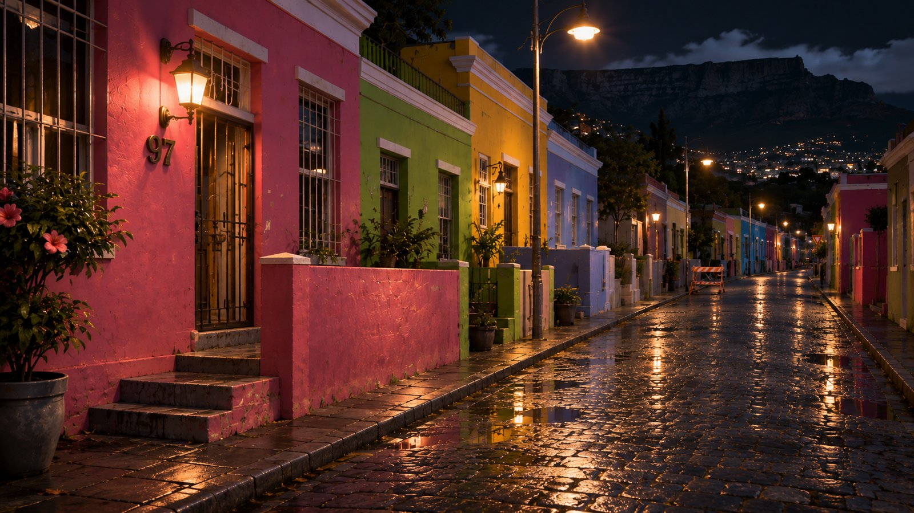
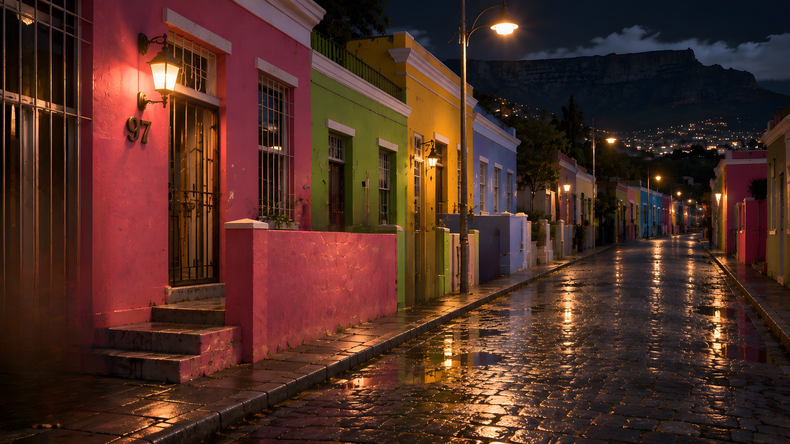
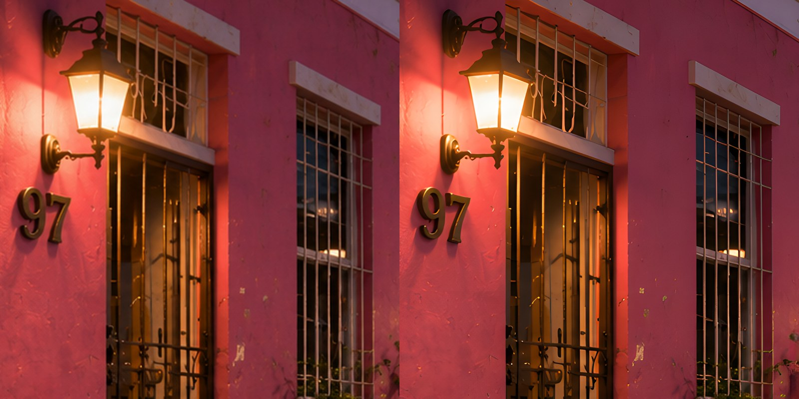
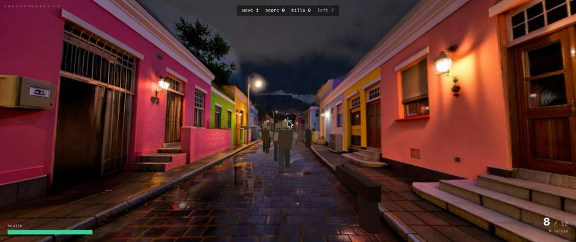
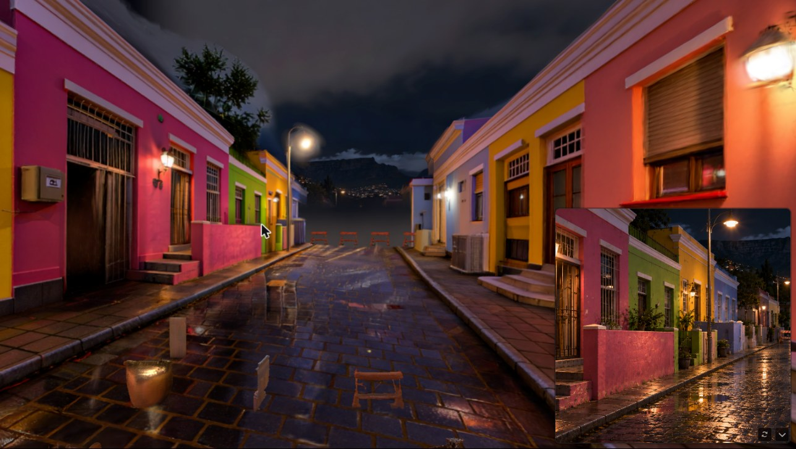
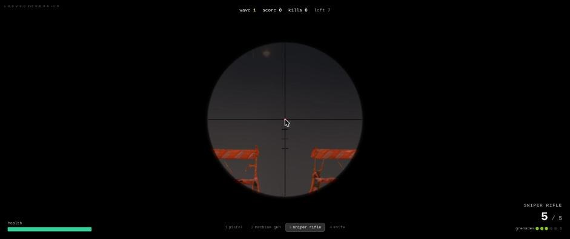
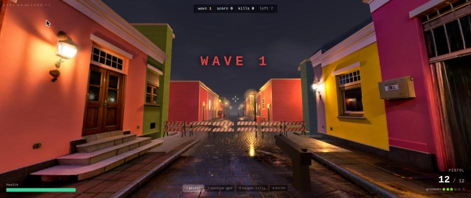

# local-gen: run IMAGE-BLASTER on your own GPU

Drop-in local replacements for the FAL-hosted steps of IMAGE-BLASTER, built and tested on an
**RTX 5060 Laptop GPU (8 GB VRAM, Blackwell sm_120)** running Ubuntu.

FAL is pay-per-use, and my account was locked once its balance ran out (`403 User is locked. Reason: Exhausted balance`).
I rebuilt the plate, upscale, and 3D steps so they run on the laptop GPU instead. World Labs stays in the cloud.
Every script writes the same indexed files (`N-slug.ext` + hidden `.N-slug-request.json`) as the original
pipeline, so the viewer picks the results up with no app changes.

| step | original (cloud) | local-gen (your GPU) | VRAM |
|---|---|---|---|
| clean plate | FAL nano-banana / gpt-image-2 edit | **LaMa** (`plate_lama.py`) | ~2 GB |
| plate sharpening | none | **Real-ESRGAN x4plus**, tiled fp16 (`upscale_esrgan.py`) | ~1.5 GB |
| object reference | FAL image edit | crop + **Real-ESRGAN** + **BiRefNet** cutout | ~1.5 GB |
| image → 3D | FAL Hunyuan 3D | **Stable Fast 3D** (`object_sf3d.py`) | ~6.1 GB peak |
| world | World Labs `marble-1.1` | unchanged (cloud) | none |
| skyline backdrop | none | ESRGAN 8K pano + photo composite (`pano_composite.py`) | ~2 GB |

## Pipeline showcase: Rainy Bo-Kaap at night

| original input | LaMa clean plate (props removed) |
|---|---|
|  |  |

| Real-ESRGAN HD plate (3344×1882) | World Labs panorama from the HD plate |
|---|---|
|  |  |

Detail, original (left) vs ESRGAN HD plate (right):



## What I changed to make it work

1. **`.env` key names.** The scripts read `WORLD_LABS_API_KEY` and `FAL_KEY`, and mine were saved as `WORLDLABS` / `FAL`.
   I renamed them, and added `HF_TOKEN` for the gated Stability models.
2. **No Bun.** `bun run dev` fails if Bun isn't installed. The viewer runs fine with
   `cd app && npm install && npm run dev`.
3. **Blackwell GPU support.** RTX 50xx needs PyTorch built for CUDA 12.8+ (`--index-url .../whl/cu128`).
   I used `uv` with a Python 3.12 venv, since the system Python 3.14 is too new for most ML wheels.
4. **LaMa without the wrapper.** `simple-lama-inpainting` pins Pillow 9.5, which won't build on modern Python.
   I load the `big-lama.pt` TorchScript directly instead (`plate_lama.py`).
5. **Real-ESRGAN without basicsr.** `basicsr` is broken on current torchvision, so I load the weights with
   [spandrel](https://github.com/chaiNNer-org/spandrel) and run a tiled fp16 upscale to keep VRAM low.
6. **Feed World Labs more pixels.** The source photo is only 1672×941. World Labs accepts the full 3344×1882
   ESRGAN plate, so the world gets twice the resolution to work from (`world/1-*` is the HD run, `world/0-*` the original).
7. **Stable Fast 3D on 8 GB.** Built the `texture_baker` / `uv_unwrapper` extensions CPU-only (no `nvcc` needed),
   prepped all references first, then freed ESRGAN before loading SF3D so only one model sits in VRAM at a time.
   Tiny props (a 25 px yield sign) get one or two ESRGAN passes before cutout.
   The CPU-only `texture_baker` can't take CUDA tensors, so `object_sf3d.py` routes only the bake step through the CPU.
   *Result:* all 7 Bo-Kaap props come out as textured GLBs. After warm-up, each mesh takes under 1 s at about 6.1 GB VRAM peak.
8. **Dependency pins.** `transformers<5` needs `huggingface_hub<1.0`, which needs `diffusers==0.35.2` (see `requirements.txt`).
9. **Watch other GPU tenants.** A resident Ollama model held 3 GB of VRAM and made SF3D run out of memory.
   Run `ollama stop <model>` before generating meshes.

## Setup

```bash
V=~/.cache/image-blaster-local/venv
uv venv --python 3.12 $V
uv pip install --python $V/bin/python torch torchvision --index-url https://download.pytorch.org/whl/cu128
uv pip install --python $V/bin/python -r local-gen/requirements.txt

mkdir -p ~/.cache/image-blaster-local/models
curl -L -o ~/.cache/image-blaster-local/models/big-lama.pt \
  https://github.com/enesmsahin/simple-lama-inpainting/releases/download/v0.1.0/big-lama.pt
curl -L -o ~/.cache/image-blaster-local/models/RealESRGAN_x4plus.pth \
  https://github.com/xinntao/Real-ESRGAN/releases/download/v0.1.0/RealESRGAN_x4plus.pth

# Stable Fast 3D source + extensions (accept the license on Hugging Face first)
curl -L https://codeload.github.com/Stability-AI/stable-fast-3d/tar.gz/refs/heads/main | \
  tar xz -C ~/.cache/image-blaster-local && mv ~/.cache/image-blaster-local/stable-fast-3d-main ~/.cache/image-blaster-local/sf3d
uv pip install --python $V/bin/python --no-build-isolation \
  ~/.cache/image-blaster-local/sf3d/texture_baker ~/.cache/image-blaster-local/sf3d/uv_unwrapper
```

## Usage

```bash
PY=~/.cache/image-blaster-local/venv/bin/python
W=rainy-bo-kaap-night-reflections

# 1. clean plate: boxes are [x0,y0,x1,y1] fractions of the image
$PY local-gen/plate_lama.py --repo-root . --world $W \
  --input worlds/$W/source/0-$W.png --regions local-gen/regions/$W-plate.json --slug $W-plate

# 2. HD plate for a sharper World Labs world
$PY local-gen/upscale_esrgan.py --repo-root . --input worlds/$W/source/1-$W-plate.png --slug $W-plate-hd

# 3. 3D props (needs HF_TOKEN with stabilityai/stable-fast-3d access)
HF_TOKEN=... PYTORCH_CUDA_ALLOC_CONF=expandable_segments:True \
$PY local-gen/object_sf3d.py --repo-root . --world $W \
  --image worlds/$W/source/0-$W.png --jobs local-gen/regions/$W-objects.json
```

Then generate the world from the newest plate with the normal `image-blast-world` skill.

## Playable demo: BO-KAAP: LAST NIGHT (zombie FPS)

A small zombie-survival FPS that runs **inside the generated world**: press **Play** in the viewer sidebar.



| Table Mountain skyline backdrop | Sniper scope |
|---|---|
|  |  |

**Arena walls hide the smeared splats.** A single-image world only reconstructs cleanly near the
camera. `worlds/<slug>/game.json` defines a street-aligned arena, and opaque backdrop walls close off
both ends. They draw in the opaque pass, so they write depth before Spark draws the splats: the smear
behind them is depth-tested away. Invisible side colliders keep the player on the street, and a row of
the generated **striped road barriers** marks each end.

**Table Mountain skyline.** `pano_composite.py` finds where the source photo sits inside the World Labs
360° panorama: it searches yaw, pitch and FOV, scoring with NCC on edge maps (the Bo-Kaap fit was yaw -89.8°, FOV 54.4°, NCC 0.91).
It then paints the sharp HD plate back into an ESRGAN-upscaled 8K pano. The far wall samples that pano along the view ray, like a skybox, but
**only inside a cone above the horizon, down the street**. The pano's own street and houses never line up with the
3D street, so below the skyline a lamp-lit fog bank takes over and you get the real mountain and city lights.

**Gameplay** (all procedural: no external models, textures or audio files; sounds are synthesized with WebAudio):

| key | action |
|---|---|
| WASD / shift / space | move / sprint / jump |
| left click | shoot. Hold for the machine gun |
| right click | aim down sights. The sniper gets a 6× scope |
| 1 2 3 4 / wheel | pistol · machine gun · sniper · knife |
| V | knife |
| G | grenade: bounces, 1.8 s fuse, splash damage, can hurt you |
| R | reload |

| weapon | mag | notes |
|---|---|---|
| pistol | 12 | semi-auto, headshot = one-tap |
| machine gun | 40 | full auto, spread tightens on ADS |
| sniper rifle | 5 | scoped, one-shots and **pierces** every zombie in line |
| knife | n/a | melee, 1.9 m |
| grenade | 3 (+1 per wave, max 5) | 5.5 m blast radius |

Zombies are built from primitives and walk out of the fog walls in waves. They get faster and tougher each wave and lurch, crowd and claw at you.

`game.json` (Bo-Kaap copy: `local-gen/regions/rainy-bo-kaap-night-reflections-game.json`):

```json
{
  "arena": {
    "origin": [0, 0, -1], "forward": [0.336, 0, -0.942],
    "halfWidth": 4.2, "front": 24, "back": 5, "wallHeight": 45, "wallOverhang": 30,
    "backdrop": "output/backdrop/1-pano-hd-composite.jpg", "backdropYaw": -1.5708,
    "skylineMinElevation": 3, "skylineHalfAngle": 32
  }
}
```

`origin` / `forward` / `halfWidth` come from profiling the World Labs collider mesh around spawn (floor vertices per slice along the street).

```bash
# 8K backdrop + photo composite
$PY local-gen/upscale_esrgan.py --repo-root . --input worlds/$W/output/world/1-world-pano.png \
  --slug pano-hd --target-width 8192 --out-dir worlds/$W/output/backdrop --ext jpg
$PY local-gen/pano_composite.py --repo-root . --pano worlds/$W/output/backdrop/0-pano-hd.jpg \
  --match-pano worlds/$W/output/world/1-world-pano.png --photo worlds/$W/source/2-$W-plate-hd.png \
  --out-dir worlds/$W/output/backdrop
cp local-gen/regions/$W-game.json worlds/$W/game.json
```

## Realism pass: a city around the scan

A single photo only reconstructs what the camera saw, so the scan looks right near the photo spot
and smears everywhere else. The stage keeps the scan exactly where it is good and builds a real 3D
neighbourhood around it.



| script | what it does |
|---|---|
| `clip_splats.py` | cuts the World Labs `.spz` to the clean zone (removes ~800k smeared splats) and feathers the scan's street surface into the 3D road |
| `scan_stats.py` | measures the scan at its seams (road / facade colours, roof heights) so the 3D city can match it |
| `stage_textures.py` | tileable PBR textures: wet basalt cobbles, sidewalk slabs, plaster |
| `sky_mask.py` | masks the World Labs pano to its real sky (stops at its invented rooftops, poles and trees) |

In the viewer (`app/src/modules/stage/`), cross streets are placed where the scan ends, so the seam is a
street corner. Houses within 28 m of the scan copy its style: single-storey cottages at the measured
roof height, with stoeps, steps and a lantern at every door. Further out the houses mix one and two storeys.
Facades are drawn on canvas (sash windows, burglar bars, gated doors, cornices, rain streaks), and the
lighting is warm sodium to match the light baked into the scan. Lamp posts and barriers are modelled by hand, because
single-image 3D breaks on thin structures. The play area stays at the photo spot, and zombies walk in from the
surrounding city.

## Credits

- **IMAGE-BLASTER** by [Neilson Koerner-Safrata](https://github.com/neilsonnn) ([neilsonnn/image-blaster](https://github.com/neilsonnn/image-blaster)), MIT.
  local-gen is an add-on to their pipeline, skills, and viewer.
- [LaMa](https://github.com/advimman/lama) (Samsung AI), with the TorchScript export from [simple-lama-inpainting](https://github.com/enesmsahin/simple-lama-inpainting)
- [Real-ESRGAN](https://github.com/xinntao/Real-ESRGAN) (Xintao Wang et al.), loaded through [spandrel](https://github.com/chaiNNer-org/spandrel)
- [Stable Fast 3D](https://huggingface.co/stabilityai/stable-fast-3d) (Stability AI, Stability AI Community License)
- [BiRefNet](https://github.com/ZhengPeng7/BiRefNet), run through [rembg](https://github.com/danielgatis/rembg)
- [World Labs Marble](https://www.worldlabs.ai/) for the explorable worlds
